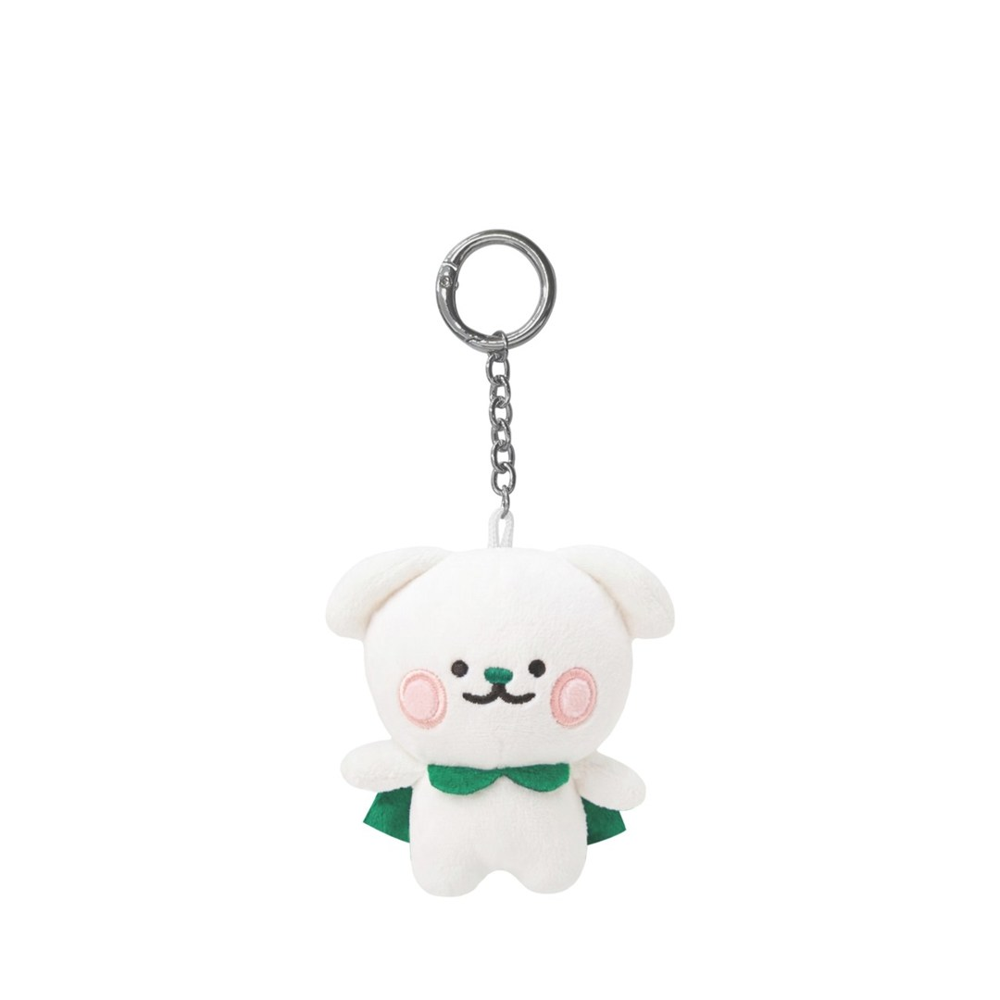
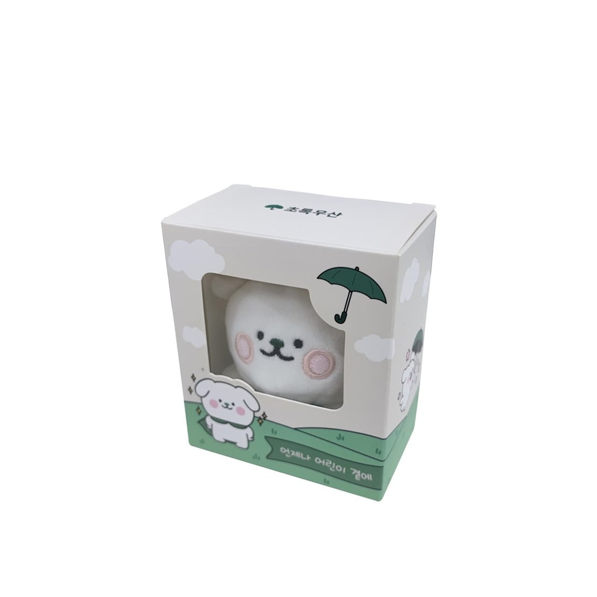

# 초록우산 초뭉이 봉제 인형키링 제작 사례 — 얼굴 자수로 만든 캠페인 기념품

_출처: https://ohyoumeee-prog.github.io/tiska-guide/posts/case-childfund-chomungi-plush-keyring.html · 게시 2026-11-24 · 주식회사 티스카_

## 한 줄 답변
초록우산(ChildFund Korea) 초뭉이 캐릭터를 보아 원단·자수실·충전솜으로 만든 봉제 인형키링으로, 같은 사양은 메인 발주 500개부터 진행합니다. 축소 패턴 설계·얼굴 자수·고리 결합 가공을 거쳐 캠페인 기념품·후원자 감사 선물·모금 행사 배포용으로 제작했습니다. 봉제·인형류 기준 샘플 1주, 양산 20일이 걸리므로 연말 행사·선물 일정에 맞춰 역산해 준비할 수 있습니다.

## 1. 제작 정보
| 항목 | 내용 |
|---|---|
| 클라이언트 | 초록우산(ChildFund Korea) |
| 품목 | 초뭉이 봉제 인형키링 |
| 소재 | 보아 원단, 자수실, 충전솜 |
| 가공 | 축소 패턴 설계, 얼굴 자수, 고리 결합 |
| 용도 | 캠페인 기념품, 후원자 감사 선물, 모금 행사 배포용 |
| 최소 수량 | 메인 발주 500개부터 |
| 샘플·양산 | 샘플 1주·양산 20일(봉제·인형류) |

## 2. 제작 포인트
- 축소 패턴 설계: 키링 크기에 맞는 전용 패턴을 설계해 작은 크기에서도 초뭉이의 형태가 유지됩니다.
- 얼굴 자수: 표정을 자수실로 표현해 보아 원단의 부피감과 어울리게 했고, 손이 자주 닿는 키링에서도 표정이 선명하게 남습니다.
- 보아 원단·충전솜·고리 결합: 부드러운 보아 원단에 충전솜을 채워 촉감을 살리고, 고리를 본체에 결합해 가방에 달 수 있는 기념품으로 완성했습니다.

## 3. 이런 곳에 어울립니다
- 캠페인 기념품: 단체 캐릭터를 그대로 담은 작은 봉제 굿즈라 캠페인 참여자에게 건네기 좋습니다.
- 후원자 감사 선물: 연말 감사 인사나 후원 리포트에 동봉하는 정기 후원자 선물로 어울립니다.
- 모금 행사 배포용: 행사장에서 참가자에게 나누는 굿즈로, 캐릭터가 있는 단체라면 같은 구성을 참고할 수 있습니다.

## 4. 같은 사양으로 만들려면
진행 순서는 문의 접수 → 무료 시안 → 사양 설계·견적(수량 구간별 단가) → 디자인 확정·샘플 → 승인 샘플 기준 양산 → 검품·납품입니다.

샘플 1주와 양산 20일만 더해도 약 4주입니다. 모금 행사나 후원자 선물 발송에 맞추려면 시안 확정과 검품·배송 여유를 더해 행사일 6주 전에는 문의하시는 것을 권합니다(표준 기간을 더한 권장치).

캐릭터 원화·로고는 AI·PDF·PSD 원본이 있으면 자수의 선 굵기와 색 수를 정확히 옮길 수 있고, JPG·PNG만 있어도 디자인팀이 도안 작업을 지원합니다. 준비 절차는 "비영리단체 캠페인 굿즈·후원자 선물, 어떻게 준비해야 할까?" 글을 참고하세요.

원본 사례 보기: https://tiska.kr/board/magazine/read.html?no=211&board_no=5

## 자주 묻는 질문
**Q. 저희 단체 캐릭터로 같은 사양의 인형키링을 만들 수 있나요?**
네. 소재와 가공 구성은 그대로 두고 캐릭터 도안만 바꿔 진행합니다. 패턴은 캐릭터 비율에 맞춰 새로 설계하고, 샘플 확인 뒤 양산합니다.

**Q. 수량과 단가는 어떻게 안내되나요?**
메인 발주는 500개부터 진행하며, 수량 구간별 단가는 견적 시 안내합니다. 500개 미만의 소량이 필요하면 자체 소량 제작 쇼핑몰 나도메이커(nadomaker.com)에서 제작할 수 있습니다.

**Q. 제작 기간은 얼마나 걸리나요?**
봉제·인형류 기준 샘플 1주, 양산 20일입니다. 시안 확정과 검품·배송 여유를 더해 행사일 6주 전쯤 문의하시면 됩니다(표준 기간을 더한 권장치).

---
**문의** 주식회사 티스카(TISKA) · 본사 서울 성동구 성수동 · 자체 공장 서울 중랑구
전화 02-930-8000 · 이메일 ttiska@naver.com · 홈페이지 https://tiska.kr · 소량 제작 https://nadomaker.com
