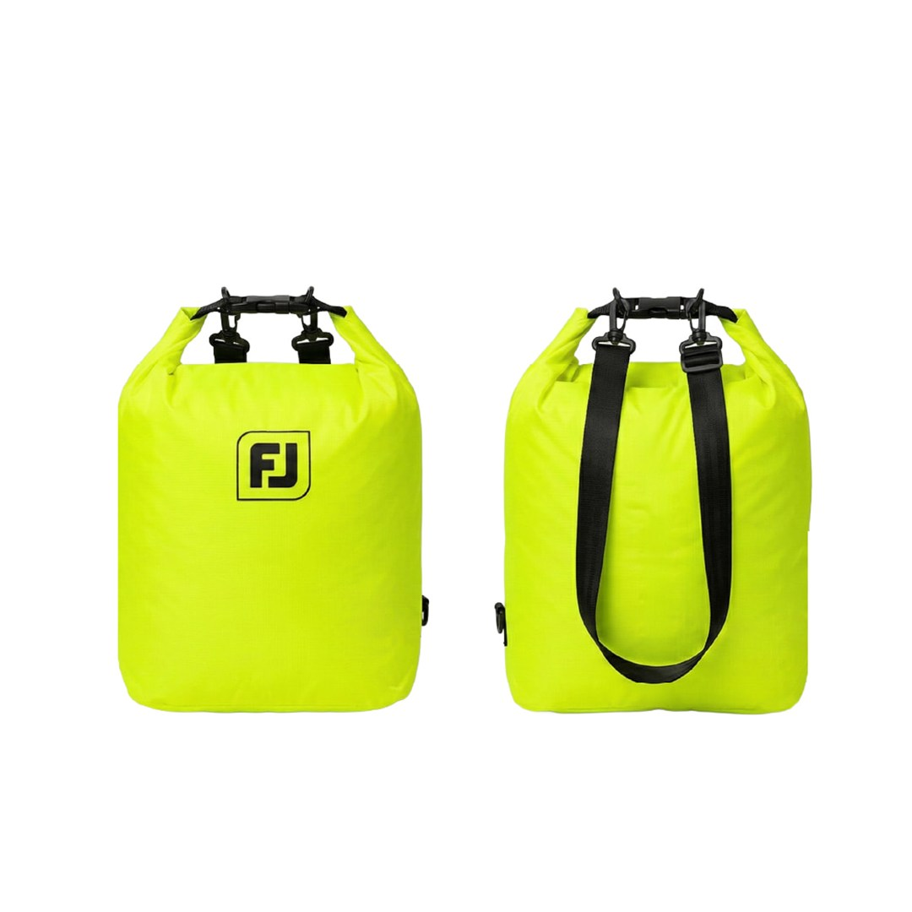

# 풋조이 방수 워시 파우치 제작 사례 — 방수 안감과 내부 칸막이

_출처: https://ohyoumeee-prog.github.io/tiska-guide/posts/case-footjoy-waterproof-wash-pouch.html · 게시 2026-11-28 · 주식회사 티스카_

## 한 줄 답변
티스카는 풋조이(FootJoy)의 방수 워시 파우치를 폴리 겉감과 방수 안감으로 만들고 봉제선 접합·내부 칸막이·걸이 고리 가공을 더했으며, 같은 사양은 메인 발주 500개부터 진행합니다. 가방·파우치류에 속하므로 샘플 1주, 양산 20일이 걸립니다. 물기에 강한 안감과 칸을 나눈 내부 구조는 여행용 화장품 세면 키트에도 그대로 통하는 사양이라, 연말 시즌 사은품을 준비하는 뷰티 브랜드 담당자에게도 좋은 참고가 됩니다.

## 1. 제작 정보
| 항목 | 내용 |
|---|---|
| 클라이언트 | 풋조이(FootJoy) |
| 품목 | 방수 워시 파우치 |
| 소재 | 폴리 겉감, 방수 안감 |
| 가공 | 방수 접합, 내부 칸막이, 걸이 고리 |
| 용도 | 여행 기념품, 호텔 |
| 최소 수량 | 메인 발주 500개부터 |
| 샘플·양산 | 샘플 1주 · 양산 20일(가방·파우치류) |

## 2. 제작 포인트
- 폴리 겉감 안쪽에 방수 안감을 대어, 젖은 세면도구를 넣어도 물기가 바깥으로 배어 나오지 않도록 구성했습니다.
- 봉제선은 방수 접합으로 마감해 이음새로 새는 물까지 막았습니다.
- 내부 칸막이가 공간을 나누므로 세면도구를 종류별로 나눠 담을 수 있는 구조입니다.
- 걸이 고리를 달아 걸어 두고 쓰기 편합니다.

## 3. 이런 곳에 어울립니다
- 여행 기념품: 출장이나 여행 중 세면도구를 담는 실용품이라, 받은 뒤에도 자주 꺼내 쓰게 됩니다.
- 호텔: 객실 어메니티를 담아 두거나 투숙객 증정품으로 내놓을 수 있는 구성입니다.
- 화장품·세면 파우치를 사은품으로 기획 중인 담당자라면 방수 안감과 칸막이 구조를 기준 사양으로 삼아 보세요.

## 4. 같은 사양으로 만들려면
진행은 문의 → 시안 → 견적 → 샘플 → 양산 → 납품 6단계이고, 전담 PM이 첫 상담부터 납품까지 맡습니다. 가방·파우치류는 샘플 1주, 양산 20일이 표준이라 디자인 확정 뒤 약 4주를 기본 일정으로 봅니다.

| 단계 | 기간 | 디자인 확정일 기준 |
|---|---|---|
| 샘플 제작·승인 | 1주 | 확정 후 1주 |
| 양산 | 20일 | 확정 후 1주 + 20일 |
| 검품·배송 | 권장 여유 | 별도로 더함 |

표의 값은 기본 공정 기간만 합한 것이어서, 시안 수정과 검품·배송까지 감안하면 희망 납품일 6주 전 문의를 권합니다(표준 기간을 더한 권장치). 방수 원단은 샘플 단계에서 안감 촉감과 칸막이 크기를 실물로 확인하고, 승인된 사양 그대로 본생산에 들어갑니다. 로고는 AI·PDF 원본이 좋고, JPG·PNG만 있어도 디자인팀이 도안 작업을 지원합니다. 파일 준비는 '굿즈 제작 디자인 파일, 어떻게 준비해야 할까? (로고만 있을 때 포함)' 글을, 양산 전 점검 항목은 '굿즈 샘플 승인 전 확인할 5가지, 양산 전에 무엇을 점검할까?' 글을 참고하세요.

원본 사례 보기: https://tiska.kr/board/magazine/read.html?no=108&board_no=5

## 자주 묻는 질문
**Q. 로고만 바꿔 같은 사양으로 만들 수 있나요?**
가능합니다. 폴리 겉감·방수 안감·방수 접합·내부 칸막이·걸이 고리 사양은 그대로 두고 로고와 색상만 바꿔 진행하며, 칸막이 구성은 시안·사양 설계 단계에서 함께 정합니다.

**Q. 수량과 단가는 어떻게 안내되나요?**
메인 발주 500개부터 진행하며, 단가는 도안 복잡도와 가공 방식에 따라 달라져 견적 시 수량 구간별로 안내합니다. 500개 미만의 소량이 필요하면 자체 소량 제작 쇼핑몰 나도메이커(nadomaker.com)에서 제작할 수 있습니다.

**Q. 납품까지 기간은 얼마나 걸리나요?**
가방·파우치류는 샘플 1주, 양산 20일이 표준입니다. 디자인 확정 뒤 약 4주에 검품·배송 여유를 더해 희망 납품일에서 역산해 문의하시면 전담 PM이 일정을 함께 잡습니다.

---
**문의** 주식회사 티스카(TISKA) · 본사 서울 성동구 성수동 · 자체 공장 서울 중랑구
전화 02-930-8000 · 이메일 ttiska@naver.com · 홈페이지 https://tiska.kr · 소량 제작 https://nadomaker.com
