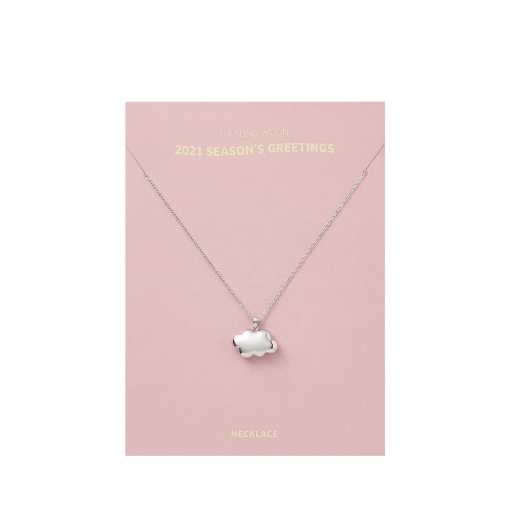

# 하성운 시즌그리팅 목걸이 제작 사례 — 펜던트를 성형하고 체인 길이까지 지정

_출처: https://ohyoumeee-prog.github.io/tiska-guide/posts/case-hasungwoon-season-greeting-necklace.html · 게시 2026-11-24 · 주식회사 티스카_

## 한 줄 답변
하성운(Ha Sung Woon) 시즌그리팅 목걸이는 써지컬 스틸 또는 아연합금으로 펜던트를 성형하고 체인 길이를 지정해 만든 금속 굿즈로, 같은 사양은 메인 발주 500개부터 제작합니다. 금속·주얼리류 기준 샘플 1주, 양산 20일이 걸리고, 팬클럽 키트와 기념일 굿즈에도 같은 구성으로 쓸 수 있습니다. 시즌그리팅은 연말에 맞춰 준비하는 MD라, 크리스마스 키트나 송년 패키지를 구성하는 담당자가 참고하기 좋은 사례입니다.

## 1. 제작 정보
| 항목 | 내용 |
|---|---|
| 클라이언트 | 하성운(Ha Sung Woon) |
| 품목 | 시즌그리팅 목걸이 |
| 소재 | 써지컬 스틸 또는 아연합금 |
| 가공 | 펜던트 성형, 체인 길이 지정 |
| 용도 | 시즌그리팅 구성품, 팬클럽 키트, 기념일 굿즈 |
| 최소 수량 | 메인 발주 500개부터 |
| 샘플·양산 | 샘플 1주 · 양산 20일(금속·주얼리류) |

## 2. 제작 포인트
- 소재는 써지컬 스틸과 아연합금 중에서 고르며, 색감과 무게감은 샘플 실물로 확인합니다.
- 펜던트는 도안에 맞춰 성형하는 방식이라, 심볼이나 로고 형태를 그대로 금속으로 옮길 수 있습니다.
- 체인 길이도 사양으로 지정했습니다. 착용 시 펜던트 위치가 길이에 따라 달라지므로 시안 단계에서 함께 정합니다.
- 용도가 시즌그리팅 구성품·팬클럽 키트·기념일 굿즈로 넓어, 다음 키트에도 그대로 다시 쓸 수 있습니다.

## 3. 이런 곳에 어울립니다
- 연말 시즌그리팅 패키지: 인쇄물 중심 구성에 실물로 남는 금속 아이템을 더하고 싶을 때
- 팬클럽 키트: 멤버십 키트의 대표 아이템으로, 회원만 가질 수 있는 상징을 담고 싶을 때
- 기념일 굿즈: 데뷔 기념일·생일처럼 소장 가치를 앞세우는 자리에 착용형 MD가 필요할 때

## 4. 같은 사양으로 만들려면
진행 순서는 문의 → 시안 → 견적 → 샘플 → 양산 → 납품의 6단계입니다. 품목·수량·희망 발송일·참고 이미지를 보내 주시면 전담 PM이 소재·펜던트 형태·체인 길이까지 사양을 잡고 수량 구간별 단가를 안내합니다.

일정은 발송일에서 역산합니다. 샘플 1주와 양산 20일을 더해 디자인 확정 뒤 약 4주를 기본으로 잡고, 검품·배송 여유는 따로 둡니다. 연말 발송이 목표라면 희망 발송일 6주 전까지 디자인을 확정하는 쪽이 안전합니다(표준 기간을 더한 권장치).

| 단계 | 기간 | 디자인 확정일 기준 |
|---|---|---|
| 샘플 제작·승인 | 1주 | 확정 후 1주 |
| 양산 | 20일 | 확정 후 약 4주 |
| 검품·배송 | 권장 여유 | 별도로 더함 |

펜던트 도안은 AI·PDF·PSD 원본이 있으면 재현도가 높고, JPG·PNG만 있어도 디자인팀이 도안 작업을 지원합니다. 파일 준비는 "굿즈 제작 디자인 파일, 어떻게 준비해야 할까?" 글을, 엔터 MD 일정 잡는 법은 "아이돌 굿즈·콘서트 MD 제작, 어디에 맡기고 일정은 어떻게 잡을까?" 글을 참고하세요.

원본 사례 보기: https://tiska.kr/board/magazine/read.html?no=141&board_no=5

## 자주 묻는 질문
**Q. 로고(심볼)만 바꿔 같은 사양으로 만들 수 있나요?**
네. 소재와 펜던트 성형, 체인 길이 지정 사양은 그대로 두고 펜던트 도안만 바꿔 진행할 수 있습니다. 도금 색이나 패키지 추가는 견적 시 함께 상담합니다.

**Q. 수량과 단가는 어떻게 안내되나요?**
메인 발주 500개부터 진행하며, 수량 구간별 단가는 도안과 가공 방식에 따라 견적 시 안내합니다. 500개 미만의 소량이 필요하면 자체 소량 제작 쇼핑몰 나도메이커(nadomaker.com)에서 제작할 수 있습니다.

**Q. 샘플과 양산 기간은 얼마나 걸리나요?**
금속·주얼리류 기준 샘플 1주, 양산 20일입니다. 양산은 승인된 샘플 기준으로 진행하며, 발송일을 알려 주시면 그 날짜에서 역산해 일정을 안내합니다.

---
**문의** 주식회사 티스카(TISKA) · 본사 서울 성동구 성수동 · 자체 공장 서울 중랑구
전화 02-930-8000 · 이메일 ttiska@naver.com · 홈페이지 https://tiska.kr · 소량 제작 https://nadomaker.com
