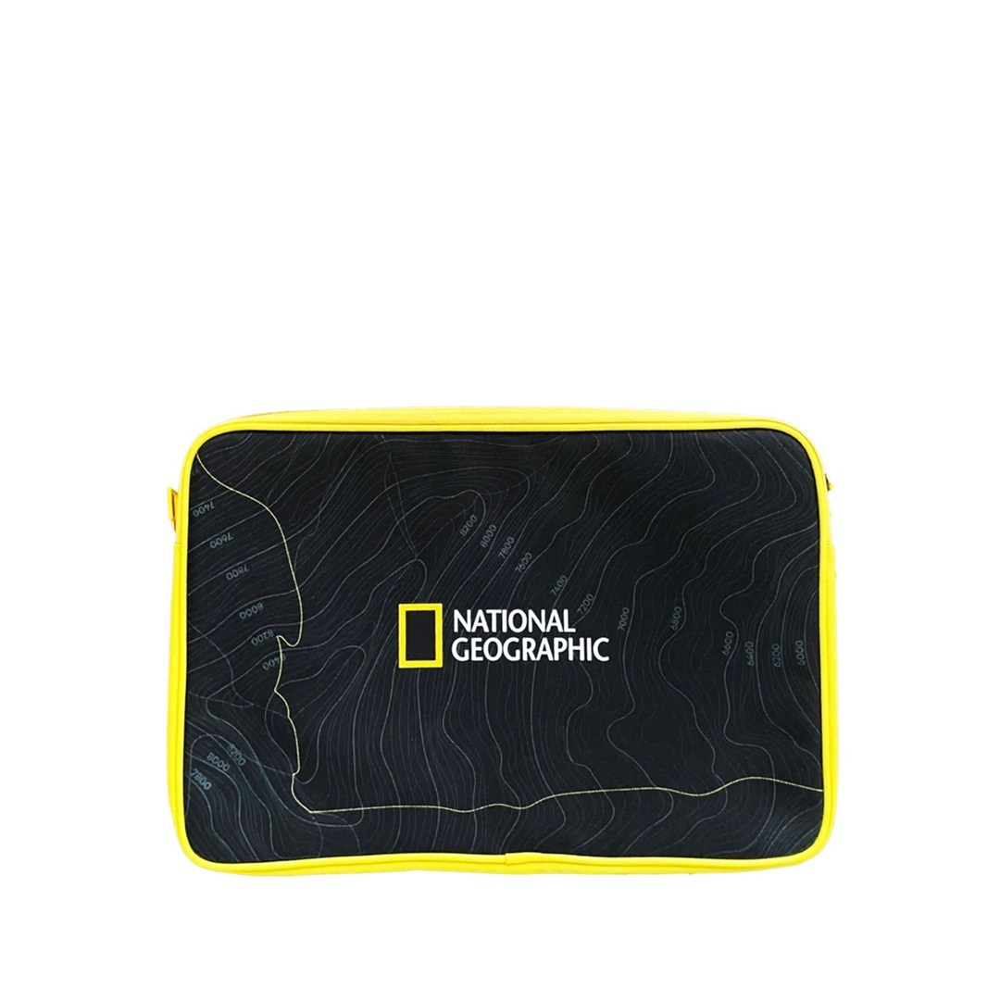

# 내셔널지오그래픽 핸들형 노트북 파우치 제작 사례 — 쿠션재와 전면 패턴 인쇄

_출처: https://ohyoumeee-prog.github.io/tiska-guide/posts/case-natgeo-laptop-pouch.html · 게시 2026-11-24 · 주식회사 티스카_

## 한 줄 답변
티스카는 내셔널지오그래픽의 핸들형 노트북 파우치를 폴리 원단에 쿠션재를 넣고 전면 패턴 인쇄·손잡이 보강·파이핑 마감으로 제작했으며, 같은 사양은 메인 발주 500개부터 진행합니다. 가방·파우치류 기준 샘플 1주, 양산 20일이 걸립니다. 기업 프로모션 제품·브랜드 콜라보 굿즈·임직원 선물 용도로 만든 사례여서, 연말 송년회·신년 시무식 선물을 준비하는 담당자가 참고하기 좋습니다.

## 1. 제작 정보
| 항목 | 내용 |
|---|---|
| 클라이언트 | 내셔널지오그래픽(National Geographic) |
| 품목 | 핸들형 노트북 파우치 |
| 소재 | 폴리 원단, 쿠션재 |
| 가공 | 전면 패턴 인쇄, 손잡이 보강, 파이핑 마감 |
| 용도 | 기업 프로모션 제품, 브랜드 콜라보 굿즈, 임직원 선물 |
| 최소 수량 | 메인 발주 500개부터 |
| 샘플·양산 | 샘플 1주 · 양산 20일(가방·파우치류) |

## 2. 제작 포인트
- 폴리 원단 본체에 쿠션재를 넣어 노트북을 완충하는 구조입니다.
- 전면 패턴 인쇄로 앞면 전체가 디자인 면이 되는 구성입니다.
- 힘이 실리는 손잡이는 보강하고, 테두리는 파이핑으로 마감해 형태를 잡았습니다.

## 3. 이런 곳에 어울립니다
- 임직원 선물: 연말 송년회·신년 시무식 선물로, 노트북을 매일 쓰는 임직원에게 실용적입니다.
- 기업 프로모션 제품: 전시회·행사 배포용이나 고객사 전달용 브랜드 굿즈로, 패턴 인쇄 면이 넓어 브랜드가 잘 드러납니다.
- 브랜드 콜라보 굿즈: 두 브랜드의 패턴·로고를 한 면에 담는 한정 수량 협업 제품에 어울립니다.

## 4. 같은 사양으로 만들려면
진행 순서는 문의 접수 → 무료 디자인 시안 → 사양 설계·견적 → 샘플 제작 → 승인 샘플 기준 양산 → 검품·납품이며, 전담 PM이 처음부터 납품까지 함께합니다.

| 단계 | 기간 | 납품 희망일 기준 역산 |
|---|---|---|
| 문의·시안·사양 확정 | 권장 여유 | 납품 6주 전까지 확정 |
| 샘플 제작·승인 | 1주 | 확정 후 1주 |
| 양산 | 20일 | 확정 후 약 4주 뒤 완료 |
| 검품·배송 | 권장 여유 | 양산 완료 뒤 납품까지 |

샘플 1주와 양산 20일만 더해도 약 4주입니다. 여기에 시안 검토와 검품·배송 여유를 더하면, 납품 희망일 6주 전에는 시안을 확정해 두시는 것을 권합니다(표준 기간을 더한 권장치). 패턴·로고는 AI·PDF·PSD 원본이 좋고, JPG·PNG만 있어도 디자인팀이 도안 작업을 지원합니다. 파일 준비는 '굿즈 제작 디자인 파일, 어떻게 준비해야 할까?', 시무식 선물 일정은 '2027년 시무식·설 임직원 선물 세트, 지금 주문하면 언제 받을까?' 글을 참고하세요.

원본 사례 보기: https://tiska.kr/board/magazine/read.html?no=139&board_no=5

## 자주 묻는 질문
**Q. 로고와 패턴만 바꿔 같은 사양으로 만들 수 있나요?**
네. 소재와 가공 구성은 그대로 두고 패턴·로고·색만 바꿔 제작하며, 크기는 사양 설계 단계에서 노트북 규격에 맞춰 정합니다.

**Q. 수량과 단가는 어떻게 안내되나요?**
메인 발주는 500개부터이며, 단가는 도안 복잡도와 가공 방식에 따라 견적 시 수량 구간별로 안내합니다. 500개 미만의 소량이 필요하면 자체 소량 제작 쇼핑몰 나도메이커(nadomaker.com)에서 제작할 수 있습니다.

**Q. 기간은 얼마나 걸리나요?**
가방·파우치류 기준 샘플 1주, 양산 20일이며, 양산은 승인된 샘플 기준으로 진행합니다.

---
**문의** 주식회사 티스카(TISKA) · 본사 서울 성동구 성수동 · 자체 공장 서울 중랑구
전화 02-930-8000 · 이메일 ttiska@naver.com · 홈페이지 https://tiska.kr · 소량 제작 https://nadomaker.com
