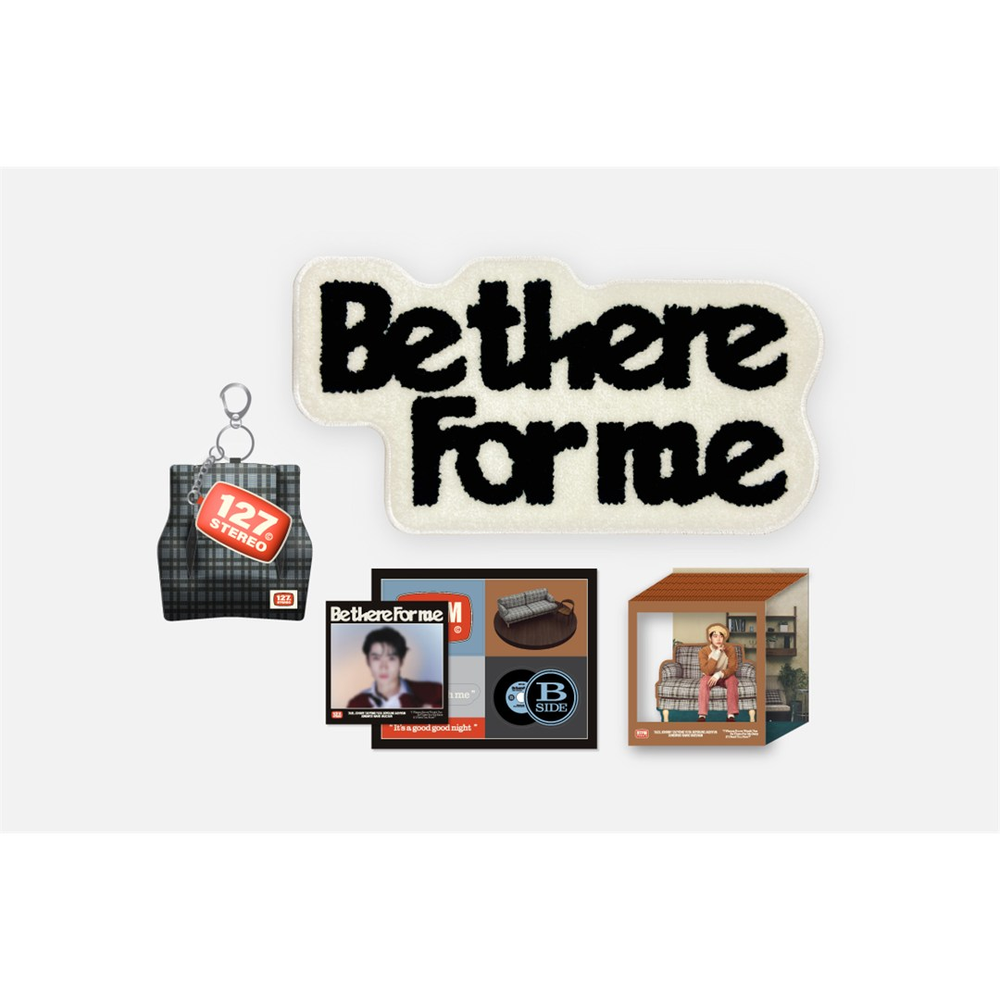
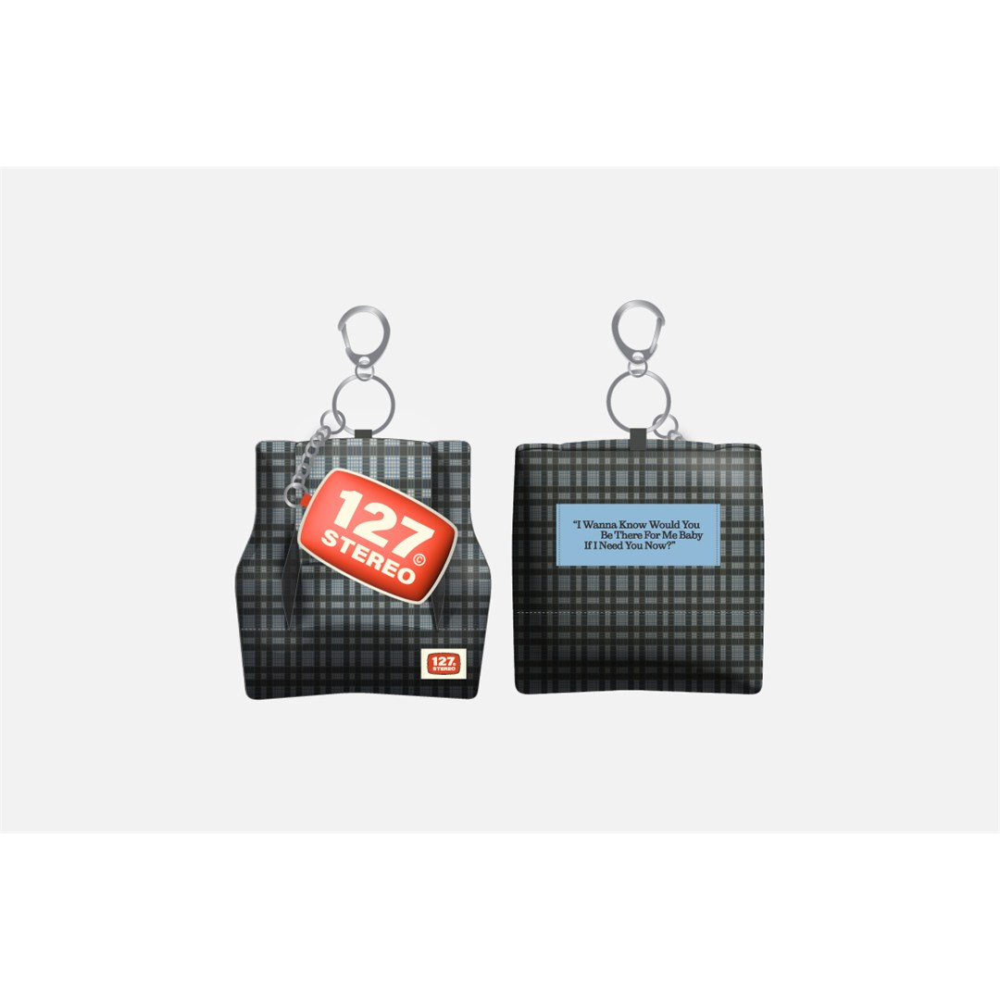

# NCT 127 겨울 스페셜 MD 5종 제작 사례 — 소파 키링부터 자수 러그까지

_출처: https://ohyoumeee-prog.github.io/tiska-guide/posts/case-nct127-winter-special-md.html · 게시 2026-11-28 · 주식회사 티스카_

## 한 줄 답변
엔시티 127(NCT 127)의 「Be There For Me」 겨울 스페셜 공식 MD 5종을 티스카가 제작했으며, 같은 구성의 시즌 굿즈도 메인 발주 500개부터 진행합니다. 미니어처 소파 키링·자수 러그·미니어처 박스 같은 입체 굿즈에 포토카드와 엽서 인쇄물을 더한 구성입니다. 샘플 1주, 양산 14~20일로 품목군마다 기간이 달라, 가장 긴 품목에 맞춰 출시 희망일에서 역산해 일정을 잡습니다.

## 1. 제작 정보
| 항목 | 내용 |
|---|---|
| 클라이언트 | 엔시티 127(NCT 127) |
| 프로젝트 | 「Be There For Me」 겨울 스페셜 |
| 제작 품목 | 미니어처 소파 키링, 자수 러그, 포토카드, 엽서, 미니어처 박스 |
| 품목 수 | 5종 |
| 최소 수량 | 메인 발주 500개부터 |
| 샘플·양산 | 샘플 1주 · 양산 14~20일(품목에 따라) |

## 2. 제작 포인트
- 소파 키링·자수 러그·미니어처 박스 등 입체 굿즈 3종에 포토카드·엽서 인쇄물 2종을 더해, 한 시즌 MD 5종으로 묶었습니다.
- 「Be There For Me」 겨울 스페셜 공식 MD로, 다섯 품목이 하나의 프로젝트 라인업으로 기획된 굿즈입니다.
- 포토카드·엽서는 문구·인쇄류(양산 14일), 소파 키링과 러그는 봉제·인형류(양산 20일)라 두 품목군의 양산 기간을 한 일정 안에서 맞춰야 했습니다.

## 3. 이런 곳에 어울립니다
- 겨울 스페셜이나 시즌그리팅처럼 계절 콘셉트가 있는 공식 MD를 준비하는 소속사·MD 기획팀
- 포토카드·엽서 인쇄물에 키링이나 러그 같은 입체 굿즈를 더해 라인업을 넓히고 싶다면 참고할 만한 구성입니다.
- 연말 팬 이벤트나 12월 팝업스토어용으로 인쇄물과 패브릭 굿즈를 같은 날 받아야 할 때도 이 역산 방식을 쓸 수 있습니다.

## 4. 같은 사양으로 만들려면
진행은 문의 → 시안 → 견적 → 샘플 → 양산 → 납품 6단계이며, 전담 PM이 첫 단계부터 끝까지 함께합니다.

소파 키링과 자수 러그는 봉제·인형류 기준 샘플 1주·양산 20일, 포토카드와 엽서는 문구·인쇄류 기준 샘플 1주·양산 14일이 표준입니다. 미니어처 박스는 사양에 따라 봉제·인형류나 패키지·세트류(양산 14일)로 나뉘므로, 사양 확정 시 품목군과 기간을 다시 안내해 드립니다.

| 단계 | 기간 | 디자인 확정일 기준 |
|---|---|---|
| 샘플 제작·승인 | 1주 | 확정 후 1주 |
| 양산 — 포토카드·엽서(문구·인쇄류) | 14일 | 확정 후 약 3주 |
| 양산 — 소파 키링·자수 러그(봉제·인형류) | 20일 | 확정 후 약 4주 |
| 양산 — 미니어처 박스(사양 확정 시 품목군 결정) | 14~20일 | 확정 후 약 3~4주 |
| 검품·배송 | 권장 여유 | 별도로 더함 |

다섯 품목을 같은 날 받으려면 가장 오래 걸리는 봉제·인형류(확정 후 약 4주)를 기준으로 역산하고, 시안 수정과 검품·배송 여유까지 더해 출시 희망일 6주 전에는 문의하시기를 권합니다(표준 기간을 더한 권장치). 로고와 아트워크는 AI·PDF·PSD 원본이 좋고, JPG·PNG만 있어도 디자인팀이 도안 작업을 도와드립니다. 파일 준비는 '굿즈 제작 디자인 파일, 어떻게 준비해야 할까?' 글을, 전체 일정은 '아이돌 굿즈·콘서트 MD 제작, 어디에 맡기고 일정은 어떻게 잡을까?' 글을 참고하세요.

원본 사례 보기: https://tiska.kr/board/gallery/read.html?no=36&board_no=8

## 자주 묻는 질문
**Q. 아트워크만 바꿔 같은 5종 구성으로 만들 수 있나요?**
네, 5종 구성을 그대로 두고 아트워크와 문구만 바꿔 진행할 수 있습니다. 품목을 더하거나 빼는 것도 견적 단계에서 조정하며, 양산은 승인된 샘플을 기준으로 합니다.

**Q. 수량과 단가는 어떻게 안내되나요?**
메인 발주 500개부터 진행하며, 단가는 도안 복잡도와 가공 방식, 수량에 따라 달라져 견적 시 수량 구간별로 안내합니다. 500개 미만의 소량이 필요하면 자체 소량 제작 쇼핑몰 나도메이커(nadomaker.com)에서 제작할 수 있습니다.

**Q. 겨울 시즌에 맞춰 5종을 한 번에 받으려면 기간은 얼마나 걸리나요?**
샘플 1주, 양산 14~20일이 표준이며, 봉제·인형류 기준으로 디자인 확정 뒤 약 4주면 다섯 품목의 양산까지 마칩니다. 검품·배송 여유를 더해 출시 희망일에서 역산해 문의하시면 전담 PM이 품목별 일정을 함께 잡아 드립니다.

---
**문의** 주식회사 티스카(TISKA) · 본사 서울 성동구 성수동 · 자체 공장 서울 중랑구
전화 02-930-8000 · 이메일 ttiska@naver.com · 홈페이지 https://tiska.kr · 소량 제작 https://nadomaker.com
