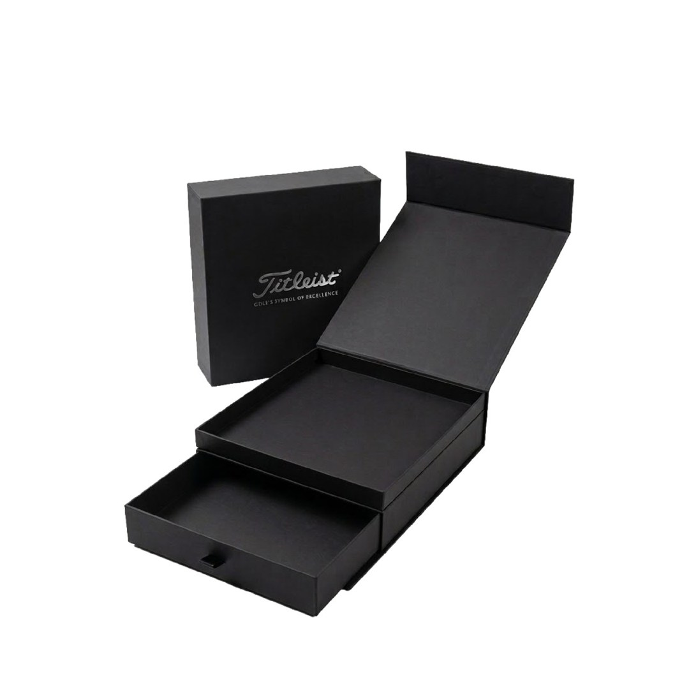

# 타이틀리스트 서랍형 기프트 패키지 제작 사례 — 손잡이를 단 2층 서랍 구조

_출처: https://ohyoumeee-prog.github.io/tiska-guide/posts/case-titleist-drawer-gift-package.html · 게시 2026-11-28 · 주식회사 티스카_

## 한 줄 답변
티스카는 타이틀리스트(Titleist)의 서랍형 기프트 패키지를 싸바리 외함 안에 서랍 구조재를 넣어 위아래 2층으로 설계하고 손잡이를 더해 제작했으며, 같은 사양은 메인 발주 500개부터 진행합니다. 패키지·세트류 기준으로 샘플 1주, 양산 14일이 걸립니다. VIP 선물·기업 명절 선물·브랜드 언박싱에 쓰인 구성이라, 연말 인사부터 설 명절까지 한 가지 사양으로 준비하려는 담당자가 참고하기 좋은 사례입니다.

## 1. 제작 정보
| 항목 | 내용 |
|---|---|
| 클라이언트 | 타이틀리스트(Titleist) |
| 품목 | 서랍형 기프트 패키지 |
| 소재 | 싸바리 외함, 서랍 구조재 |
| 가공 | 2층 서랍 설계, 손잡이 |
| 용도 | VIP 선물, 기업 명절 선물, 브랜드 언박싱 패키지 |
| 최소 수량 | 메인 발주 500개부터 |
| 샘플·양산 | 샘플 1주 · 양산 14일(패키지·세트류) |

## 2. 제작 포인트
- 싸바리 외함은 인쇄지를 감싸 붙여 만드는 단단한 상자로, 서랍이 드나드는 겉틀이자 선물의 첫인상을 정합니다.
- 서랍 구조재를 넣어 내부를 위아래 2층으로 나눴고, 위층은 뚜껑을 젖혀 열고 아래층은 서랍을 당겨서 뺍니다.
- 아래층 앞면에 단 손잡이 덕분에 아래층 서랍을 바로 꺼낼 수 있고, 뚜껑을 열고 서랍을 당기는 두 동작이 언박싱의 한 장면이 됩니다.

## 3. 이런 곳에 어울립니다
- VIP 선물: 주요 고객과 파트너에게 보낼 때, 뚜껑과 서랍을 차례로 여는 구성이 받는 순간의 인상을 남깁니다.
- 기업 명절 선물: 설·추석에 거래처와 임직원에게 보내는 선물이라면 같은 사양을 해마다 이어 쓸 수 있습니다.
- 브랜드 언박싱 패키지: 제품을 꺼내는 과정까지 브랜드 경험으로 설계하려는 마케팅팀에 맞는 구조입니다.

## 4. 같은 사양으로 만들려면
진행 순서는 문의(품목·수량·납품 희망일) → 기획·디자인(무료 시안) → 사양 설계·견적 → 디자인 확정·샘플 제작 → 양산(승인 샘플 기준) → 검품·납품으로 이어집니다.

패키지·세트류는 샘플 1주, 양산 14일이 표준이라 디자인 확정 뒤 약 3주가 기본 일정입니다.

| 단계 | 기간 | 디자인 확정일 기준 |
|---|---|---|
| 샘플 제작·승인 | 1주 | 확정 후 1주 |
| 양산 | 14일 | 확정 후 약 3주 |
| 검품·배송 | 권장 여유 | 별도로 더함 |

위 표는 표준 기간만 더한 계산입니다. 시안 수정과 검품·배송 여유까지 생각하면 납품 희망일 6주 전 문의를 권합니다(표준 기간을 더한 권장치). 연말 인사와 설 명절은 시기가 이어지므로, 두 납품일을 처음 문의할 때 함께 알려 주시면 전담 PM이 한 번에 일정을 잡습니다.

로고는 AI·PDF·PSD 원본이 좋고, JPG·PNG만 있어도 디자인팀이 도안 작업을 지원합니다(시안 무료). 파일 준비는 「굿즈 제작 디자인 파일, 어떻게 준비해야 할까?」 글을, 명절 선물 일정은 「연말 기업 선물·임직원 기프트 세트 제작, 지금 주문하면 언제 받을까?」 글을 참고하세요.

원본 사례 보기: https://tiska.kr/board/magazine/read.html?no=113&board_no=5

## 자주 묻는 질문
**Q. 로고만 바꿔 같은 사양으로 만들 수 있나요?**
네. 2층 서랍 구조와 손잡이는 유지한 채 외함 디자인과 로고만 바꾸면 되며, 담을 구성품에 맞춰 외함 규격과 서랍 치수를 다시 잡은 뒤 승인된 샘플 기준으로 양산합니다.

**Q. 수량과 단가는 어떻게 안내되나요?**
메인 발주 500개부터 진행하며, 단가는 외함 규격·도안 복잡도·가공 방식에 따라 달라져 견적 시 수량 구간별로 안내합니다. 500개 미만의 소량이 필요하면 자체 소량 제작 쇼핑몰 나도메이커(nadomaker.com)에서 제작할 수 있습니다.

**Q. 명절 납품까지 기간은 얼마나 걸리나요?**
패키지·세트류는 샘플 1주, 양산 14일이 표준입니다. 디자인 확정 뒤 약 3주에 검품·배송 여유를 더해 납품 희망일에서 역산해 문의하시면 디자인 확정 기한을 함께 안내해 드립니다.

---
**문의** 주식회사 티스카(TISKA) · 본사 서울 성동구 성수동 · 자체 공장 서울 중랑구
전화 02-930-8000 · 이메일 ttiska@naver.com · 홈페이지 https://tiska.kr · 소량 제작 https://nadomaker.com
