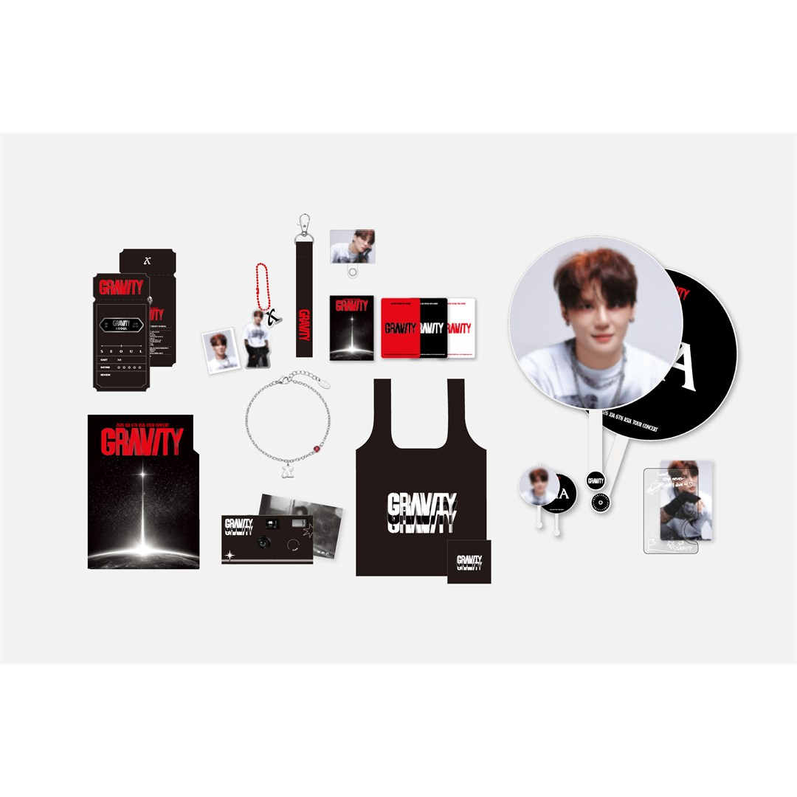
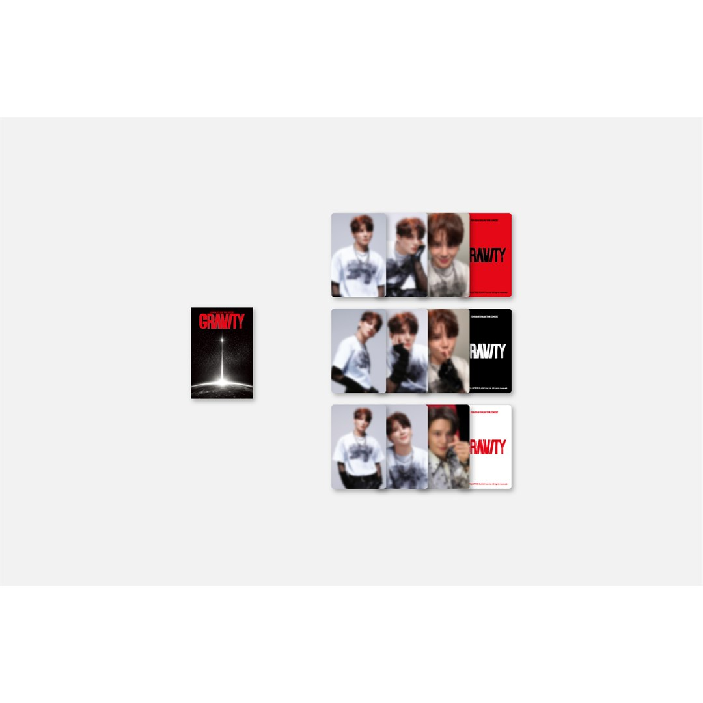

# 김준수(XIA) 콘서트 MD 9종 제작 사례 — 포토카드부터 필름카메라까지

_출처: https://ohyoumeee-prog.github.io/tiska-guide/posts/case-xia-gravity-concert-md.html · 게시 2026-11-24 · 주식회사 티스카_

## 한 줄 답변
김준수(XIA)의 2026 6th ASIA TOUR CONCERT 「GRAVITY」 IN SEOUL 공식 MD 9종을 티스카가 제작했으며, 같은 구성의 콘서트 MD도 메인 발주 500개부터 진행합니다. 인쇄물부터 아크릴 스탠드·팔찌·마켓백·필름카메라까지 품목군이 다른 9종을 한 공연 일정에 맞춰 함께 만들었습니다. 샘플 1일~2주, 양산 7~20일로 품목마다 기간이 다르므로, 가장 오래 걸리는 품목을 기준으로 공연일에서 역산해 일정을 잡습니다.

## 1. 제작 정보
| 항목 | 내용 |
|---|---|
| 클라이언트 | 김준수(XIA) |
| 프로젝트 | 2026 6th ASIA TOUR CONCERT 「GRAVITY」 IN SEOUL |
| 제작 품목 | 포토카드, 스트랩 키링, 아크릴 스탠드, 팔찌, 마켓백, 원형 부채, 일회용 필름카메라, 포스터, 티켓형 카드 |
| 품목 수 | 9종 |
| 최소 수량 | 메인 발주 500개부터 |
| 샘플·양산 | 샘플 1일~2주 · 양산 7~20일(품목에 따라) |

## 2. 제작 포인트
- 품목군이 여럿이라 샘플·양산 기간이 품목마다 다릅니다.
- 양산 7일인 아크릴 품목부터 20일인 팔찌·마켓백·필름카메라까지 한 공연 MD로 함께 만든 것이 이 사례의 핵심입니다.
- 포토카드·포스터 같은 인쇄물과 부채·마켓백·팔찌 같은 실물 굿즈로 MD 라인업을 구성했습니다.

## 3. 이런 곳에 어울립니다
- 콘서트·팬미팅 공식 MD를 여러 품목군으로 한 번에 준비하는 소속사·MD 기획자
- 인쇄물과 실물 굿즈를 공연일에 맞춰 같은 날 받아야 하는 투어·단독 공연 MD 팀
- 인쇄물에 키링·스탠드·마켓백을 더해 한 세트로 묶으려는 아티스트·캐릭터 IP 브랜드

## 4. 같은 사양으로 만들려면
진행은 문의 → 시안 → 견적 → 샘플 → 양산 → 납품 6단계로, 전담 PM이 끝까지 함께합니다. 연말에는 콘서트와 시즌그리팅 준비가 겹치기 쉬워, 품목군이 다른 9종을 한 공연 일정에 맞춘 이 사례가 11~12월 MD 계획에 참고가 됩니다.

| 품목군(이 사례의 품목) | 샘플 | 양산 |
|---|---|---|
| 아크릴·키링류(아크릴 스탠드, 원형 부채) | 1일 | 7일 |
| 문구·인쇄류(포토카드, 포스터, 티켓형 카드) | 1주 | 14일 |
| 금속·주얼리류(팔찌), 가방·파우치류(마켓백) | 1주 | 20일 |
| 기타(일회용 필름카메라) | 2주 | 20일 |

스트랩 키링은 소재에 따라 품목군이 달라지므로, 사양을 확정할 때 기간을 안내해 드립니다. 필름카메라 기준 샘플 2주·양산 20일만 더해도 약 5주이므로, 시안 확정과 검품·배송 여유를 더해 공연일 7주 전 문의를 권합니다(표준 기간을 더한 권장치).

로고·아트워크는 AI·PDF·PSD 원본이 좋고, JPG·PNG만 있어도 디자인팀이 도안을 지원합니다(시안 무료). 파일 준비는 "굿즈 제작 디자인 파일, 어떻게 준비해야 할까?" 글을, 일정은 "아이돌 굿즈·콘서트 MD 제작, 어디에 맡기고 일정은 어떻게 잡을까?" 글을 참고하세요.

원본 사례 보기: https://tiska.kr/board/gallery/read.html?no=167&board_no=8

## 자주 묻는 질문
**Q. 로고와 아트워크만 바꿔 같은 9종 구성으로 만들 수 있나요?**
네. 9종 구성을 기준으로 품목을 더하거나 빼서 견적을 받을 수 있고, 양산은 승인된 샘플 기준으로 진행합니다.

**Q. 수량과 단가는 어떻게 안내되나요?**
메인 발주는 500개부터이며, 수량 구간별 단가는 품목별 사양을 받아 견적으로 안내합니다. 500개 미만의 소량이 필요하면 자체 소량 제작 쇼핑몰 나도메이커(nadomaker.com)에서 제작할 수 있습니다.

**Q. 9종을 한 번에 만들면 기간은 얼마나 걸리나요?**
샘플 1일~2주, 양산 7~20일이 표준이며, 가장 긴 품목(이 사례는 필름카메라) 기준으로 잡으면 나머지도 같은 날 납품할 수 있습니다.

---
**문의** 주식회사 티스카(TISKA) · 본사 서울 성동구 성수동 · 자체 공장 서울 중랑구
전화 02-930-8000 · 이메일 ttiska@naver.com · 홈페이지 https://tiska.kr · 소량 제작 https://nadomaker.com
